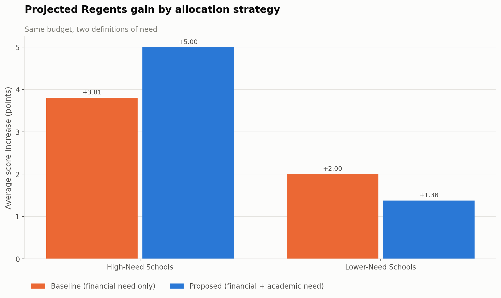

# NYC Title I Funding Optimizer

Where should New York City send $500M of discretionary school funding?

The NYC Department of Education allocates discretionary Title I dollars on
**financial need alone**. This project asks what changes if you score
**academic need** too — and answers it with a linear program over 349 Title I
high schools, a test suite, and a dashboard.

The short version: on the same budget, blending the two definitions of need
lifts the average high-need school by **+5.0 Regents points** instead of
**+3.8**, and narrows the gap between need tiers from **9.5 points to 5.9**.
It does that by making funding *less* equal on purpose.

<p align="center">
  
</p>

---

## What's here

| | |
|---|---|
| `src/titlei/` | The model: data prep, need scoring, the LP, outcome projection, metrics, charts |
| `dashboard/app.py` | Interactive Streamlit dashboard — move the budget and weights, watch the allocation change |
| `outputs/charts/`, `outputs/tables/` | The generated charts and result tables, tracked so they are browsable here |
| `tests/` | 66 tests, including a golden regression against the original analysis |
| `docs/methodology.md` | The model written out, and what it does *not* support |
| `data/raw/` | 349 NYC Title I high schools with funding, staffing and Regents outcomes |

This started as a spreadsheet, two scripts, and two Power BI files (an ORIE 4820
capstone). It is now a package with a CLI, a config file, tests, and CI. The
[regression suite](tests/test_regression.py) checks the rewrite against the
original per-school outputs to the last decimal — the analysis is preserved, not
approximated.

## Quickstart

```bash
pip install -e ".[dev,dashboard]"
```

```bash
titlei report --out outputs
```

That writes `outputs/report.html` — a standalone page with every chart inlined,
no server needed — plus eight PNGs and seven CSVs. For the interactive version:

```bash
streamlit run dashboard/app.py
```

### Other commands

```bash
titlei describe                              # summarise the input data
titlei run --budget 250e6                    # a different budget
titlei run --financial-weight 0.5            # a different definition of need
titlei sweep --budgets 1e8 5e8 1e9           # how results scale with the budget
```

Every parameter lives in [`config/model.yaml`](config/model.yaml) and can be
overridden on the command line.

## How the model works

**1 · Score need.** Two z-scores per school — the share of students on free or
reduced-price lunch, and the Regents average *inverted* so that low scores mean
high need. Blend them 30/70 and clip at 0.1:

```
weight = clip(0.30 · z(FRPL share) + 0.70 · (−z(Regents score)), min=0.10)
```

Schools left at the clip floor form the **lower-need** tier (178 schools);
everything above it is **high-need** (171 schools).

**2 · Allocate.** A linear program maximising need-weighted dollars:

```
maximise   Σ wᵢ · xᵢ
s.t.       Σ xᵢ ≤ $500,000,000
           lᵢ ≤ xᵢ ≤ capᵢ · enrollmentᵢ
```

The cap is $5,000 per pupil for high-need schools and $1,500 for the rest.
Schools averaging below 60 on the Regents are guaranteed $50,000 so the
optimiser cannot zero them out.

**3 · Project outcomes.** Each extra dollar per pupil is modelled as 0.001
Regents points. **This is an assumption, not an estimate** — see
[Limitations](#limitations).

The baseline it is compared against uses the identical LP with financial need as
the only weight — the DOE's current practice.

## Results at $500M

| | High-need (171 schools) | Lower-need (178 schools) |
|---|---|---|
| Students | 55,174 | 155,222 |
| Regents before → after | 61.3 → **66.3** | 70.9 → **72.3** |
| Extra per pupil | **$5,000** | $1,380 |
| Share of budget | **55%** | 45% |

The whole $500M is allocated; 335 of 349 schools receive something; 204,903
students are reached. The need-tier gap closes from 9.5 points to 5.9.

**Three things the data says that are worth stating plainly:**

**Current funding barely tracks outcomes.** Per-pupil funding and Regents scores
correlate at **r = −0.16** — about 2% of the variance, and the sign is negative.
The schools already receiving the most per pupil are the ones scoring lowest.
This is the finding that justifies scoring academic need separately: if money
alone predicted outcomes, targeting poverty would already be enough.

**The model makes funding less equal, deliberately.** The Gini coefficient of
per-pupil funding *rises* from 0.099 to 0.110. High-need schools serve 26% of
the students and receive 55% of the budget. That is the intended behaviour of an
equity-weighted allocation, and it is the trade-off a reader should be shown
rather than have buried.

**Past ~$509M the model saturates.** Once every school hits its per-pupil cap,
extra budget does nothing. In the sweep, the proposed model stops absorbing
funding at $509M while the baseline keeps spending to $563M — so above ~$750M
the baseline posts a marginally higher *mean* gain (+3.23 vs +3.21) purely
because it can still place dollars. On high-need schools the proposed model
stays ahead at every budget (+5.00 vs +4.02). If the budget were really that
large, the caps are the thing to revisit, not the weights.

## Limitations

The impact model is the weak joint. `impact_factor = 0.001` — one Regents point
per $1,000 per pupil — is a linear assumption carried over from the original
study, not a coefficient estimated from data. It implies no diminishing returns,
no lag, and the same responsiveness at every school. Every "projected score" in
this repo inherits that.

So: **read the comparison, not the level.** The ranking of strategies is robust
to the constant (both strategies are scored through the same function); the
absolute point gains are not.

Further caveats — Regents averages as a proxy for academic need, the missing
counterfactual, the YABC transfer schools that dominate the proportional-gain
chart, and the single-year snapshot — are in
[`docs/methodology.md`](docs/methodology.md).

## Development

```bash
make test     # pytest
make lint     # ruff
make report   # rebuild outputs/
```

CI runs the suite on Python 3.9–3.12 and re-runs the pipeline end to end.

## Credits

Original capstone analysis (ORIE 4820): Sowoon Choi, Mukunth Gopalakrishnan,
Bradley Lasker, Sophia Mulvania, Mengwei Zhou. Source data from NYC DOE school
allocation and Regents reporting. MIT licensed.
